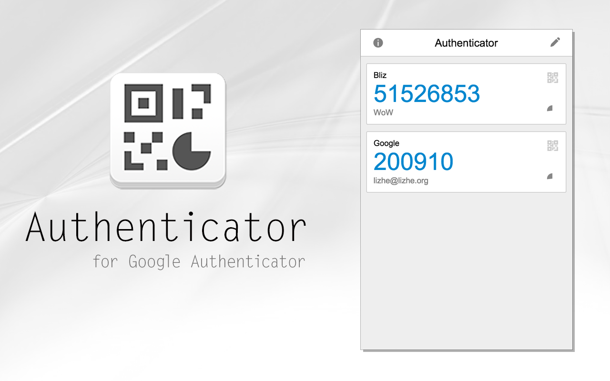
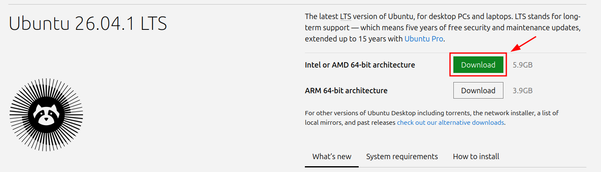
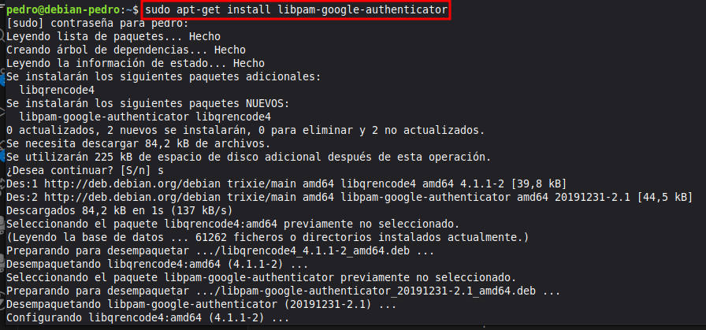
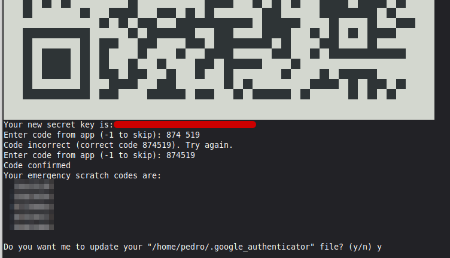
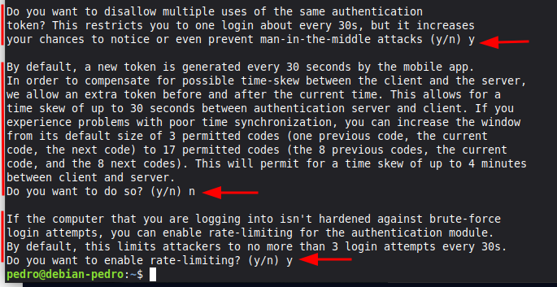

# Actividad 2.1 - 2FA con Google Authenticator

<center>
    
</center>

__Nombre:__ Pedro Martín Escuela

## Introducción

__Precauciones__: _Crea una instantánea de la máquina virtual antes de configurar los autenticadores (puede dar fallos y perder el acceso a la máquina)_

Utiliza Google Authenticator para configurar un segundo factor de autenticación en una máquina virtual Ubuntu. Puedes seguir las indicaciones de este [enlace](https://www.techradar.com/how-to/how-to-add-two-factor-authentication-to-linux-with-google-authenticator)

Si no quieres utilizar tu móvil, puedes utilizar algún emulador o [máquina virtual](https://www.genymotion.com/desktop/) de Android

Realiza un informe de cómo has desarrollado el proyecto y adjunta como comprobación las siguientes capturas:

- Pantalla con el código de 16 dígitos generado al instalar el módulo pam de google-authenticator.

- Pantalla de inicio de sesión en donde se te pide el código de acceso.

## Informe

Al empezar, descargamos una imagen de Ubuntu

<center>
    
</center>

Luego de configurar la máquina virtual correctamente, el Google Authenticator PAM de los repositorios oficiales:

```bash
sudo apt-get install libpam-google-authenticator
```

<center>
    
</center>

A continuación, comprobando que estemos en el usuario que queramos securizar, escribimos en la terminal:

```bash
google-authenticator
```

Luego te da un QR y una clave secreta, para que añadas el usuario al google auth desde la app del movil. Yo escaneé el QR, me pidió el codigo temporal que va mostrando la app, y al registrarlo procedió a mostrarme los codigos de emergencia de 1 uso:

<center>
    
</center>

Continuando con la configuración, empieza a hacerte una serie de preguntas.

- Primero, si quieres limitar el login a uno cada 30 segundos.

- Segundo, que si quieres aumentar el intervalo de tiempo para introducir el codigo de la app de 1:30 minutos a 4 minutos. Esta medida, aun que más comoda, es menos segura, así que la rechazaré.

- Tercero, si queremos limitar los intentos fallidos de iniciar sesión a 3 intentos cada 30 segundos

<center>
    
</center>

