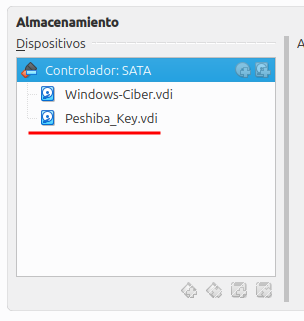
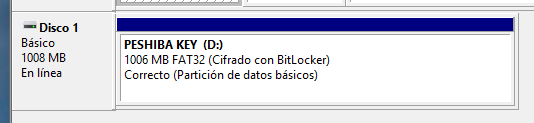
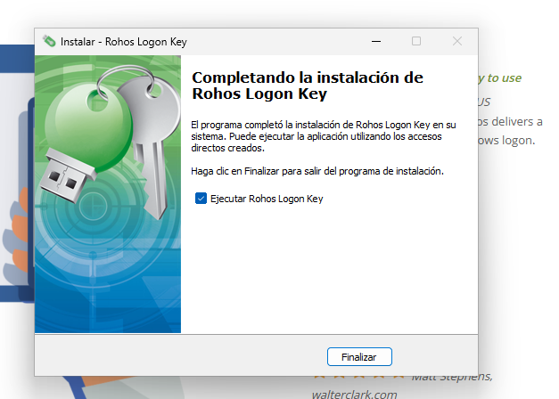
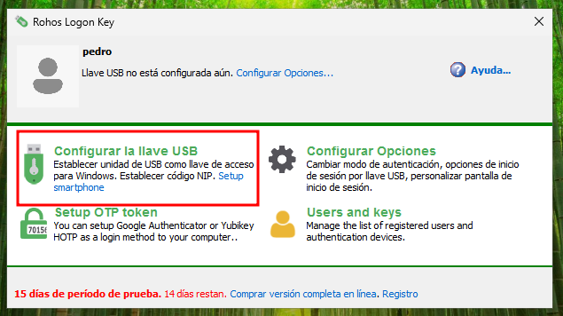
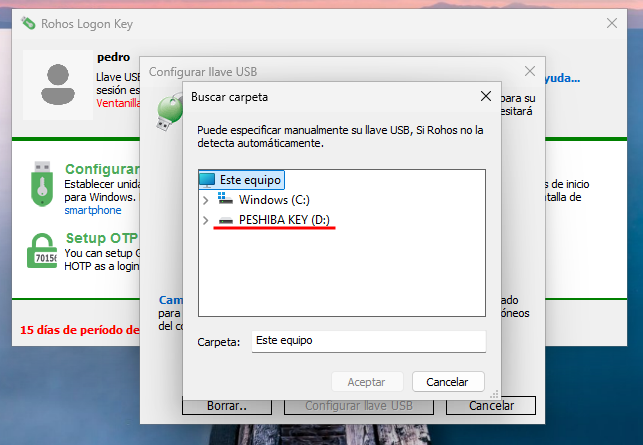
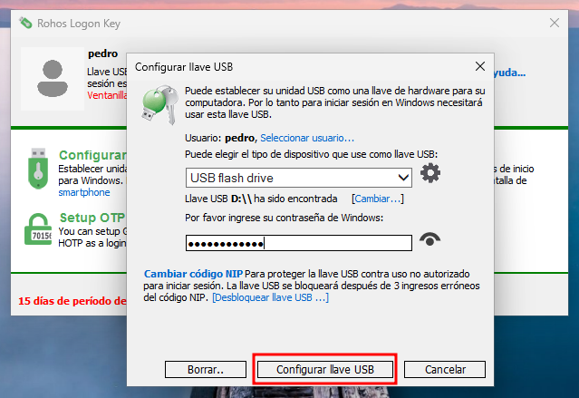
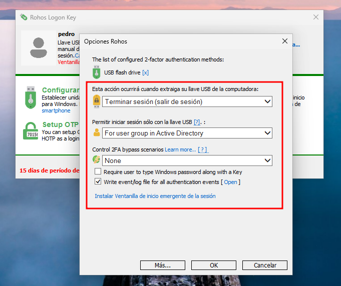
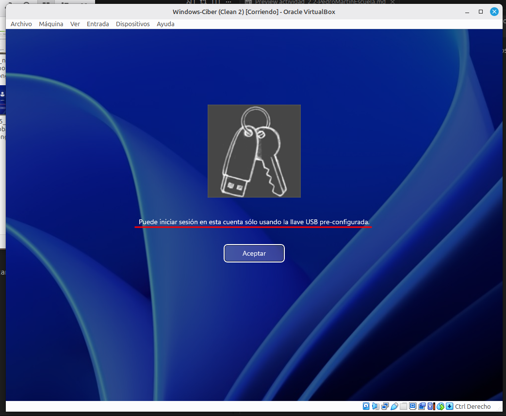
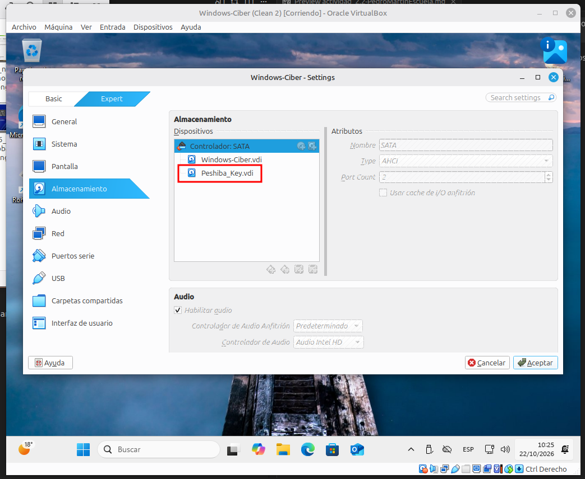
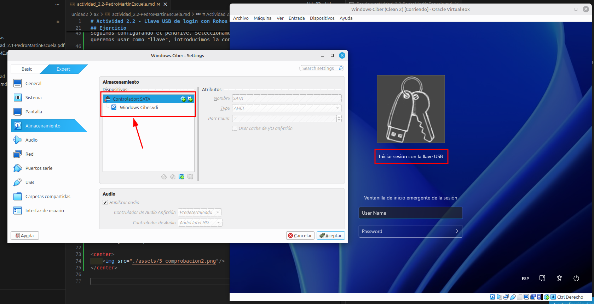

# Actividad 2.2 - Llave USB de login con Rohos

__Autor:__ Pedro Martín Escuela  
__Asignatura:__ Bastionado de Redes y Sistemas

## Índice

## Introducción

__Precauciones__: Crea una instantánea de la máquina virtual antes de configurar los autenticadores (puede dar fallos y perder el acceso a la máquina)

En esta actividad configuraremos un USB que actúe como “llave” de login de nuestro sistema Windows.

## Herramientas

Para esta actividad vamos a necesitar:

- Un pendrive USB (ningún tamaño en específico)
- Una máquina virtual con W10 o W11.
- El software Rohos Logon Key.

## Ejercicio

Utiliza __Rohos__ para configurar el __USB__ de manera que el sistema pueda iniciar sesión con nuestro usuario automáticamente al conectar la llave. Configúralo también para que al extraer la llave, la sesión se cierre automáticamente.

¿En caso de extraviarse la llave, qué opciones tendríamos para iniciar sesión?

Comenzamos preparando la máquina de Windows añadiendole un pendrive virtual desde virtual-box:

    

Luego damos formato al pendrive e instalamos Rohos:

    

    

 

>__Nota__: Antes de seguir, hacemos una instantánea a la mv, por si acaso, hagamos mal la configuración de la llave y perdamos el acceso.

Seguimos configurando el pendrive. Seleccionamos el dispositivo que queremos usar como "llave", introducimos la contraseña y confirmamos.

    

    

    

Además, configuramos algunas opciones en los ajustes de Rohos para que el usuario en concreto no pueda iniciar sesión sin conectar el usb, aun que introduzca el usuario y contraseña correctamente. También establecemos que al extraer la llave, la sesión se cierre automáticamente.

    

Comprobamos que sin insertar el __USB__, no podemos iniciar sesión:

    

Nos aseguramos que insertandolo se inicie sesión automaticamente:

    

Y que desconectándolo nos cierre sesión

    

Y con esto habremops terminado de configurar un USB como llave, con Rohos.